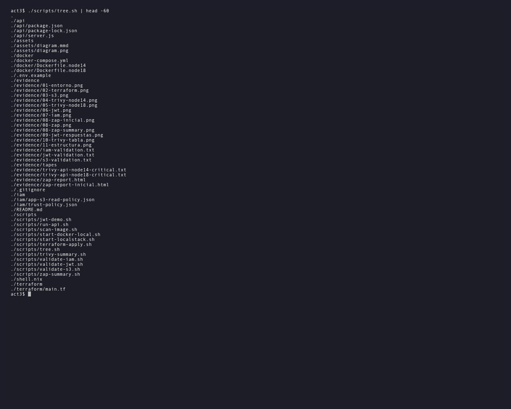
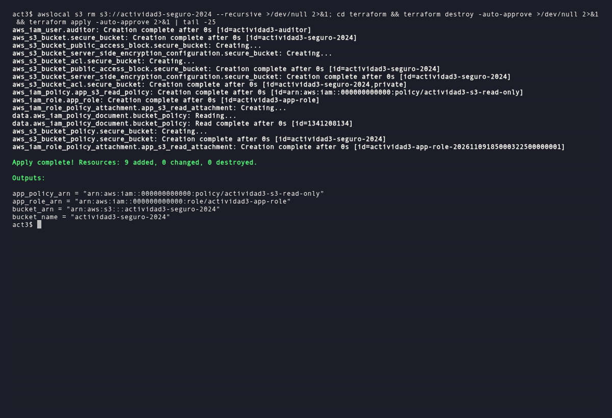
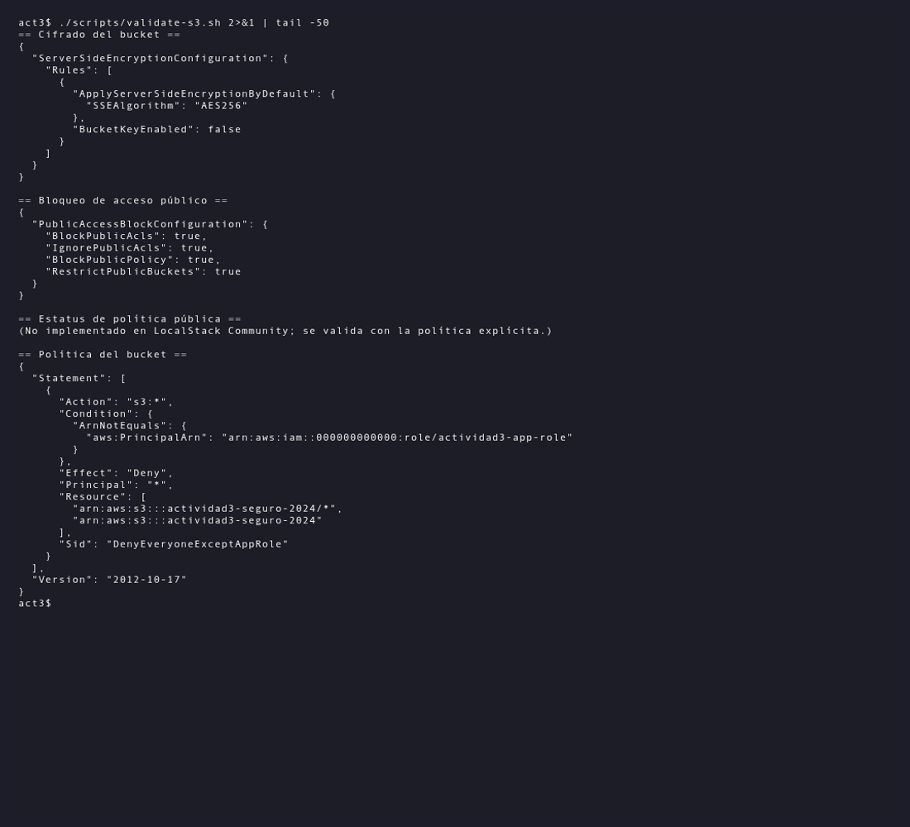
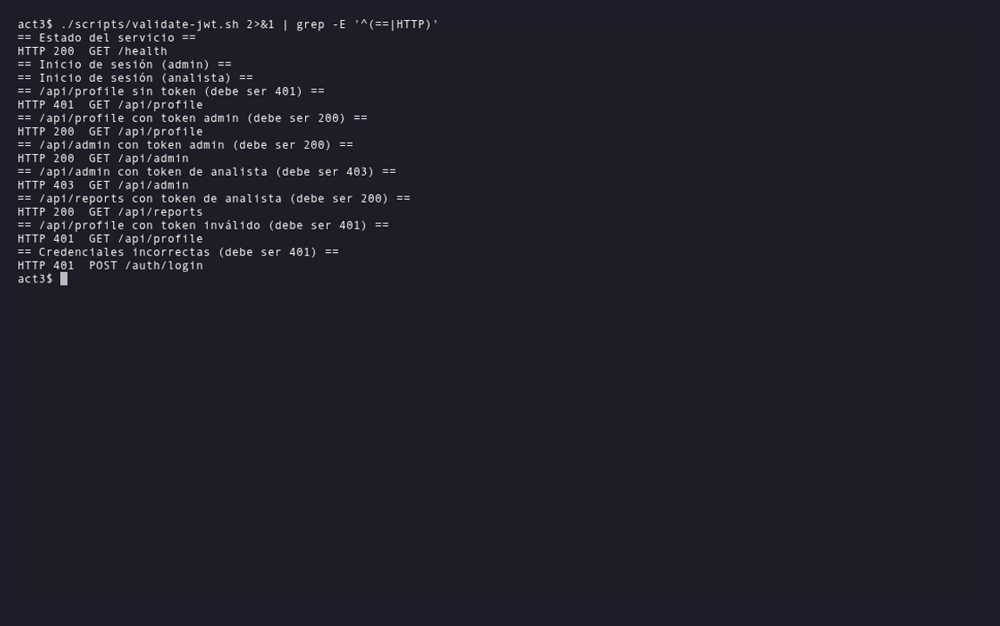
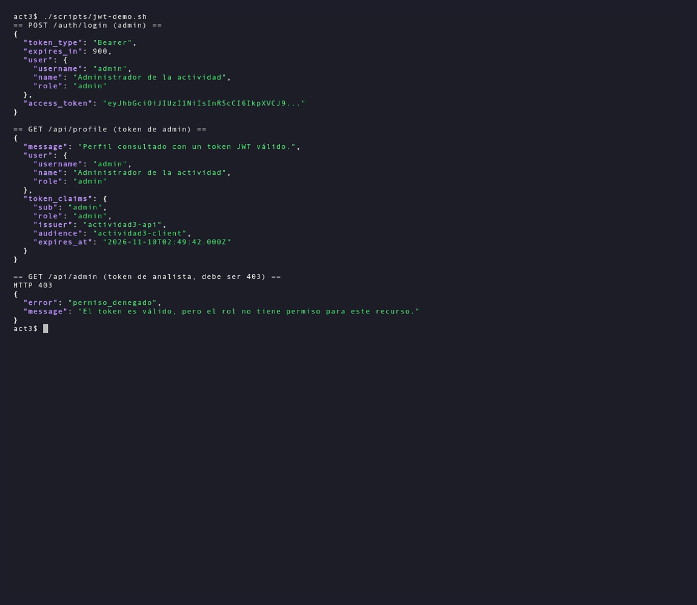
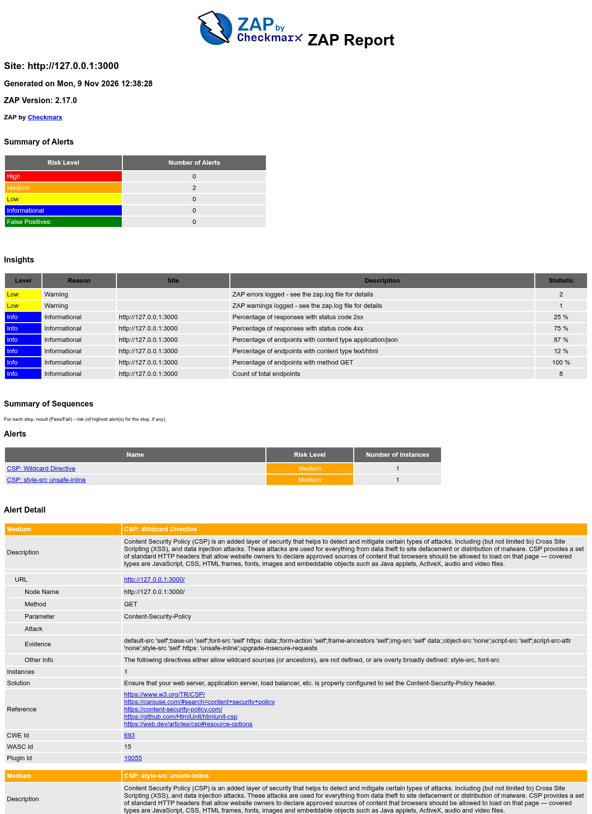
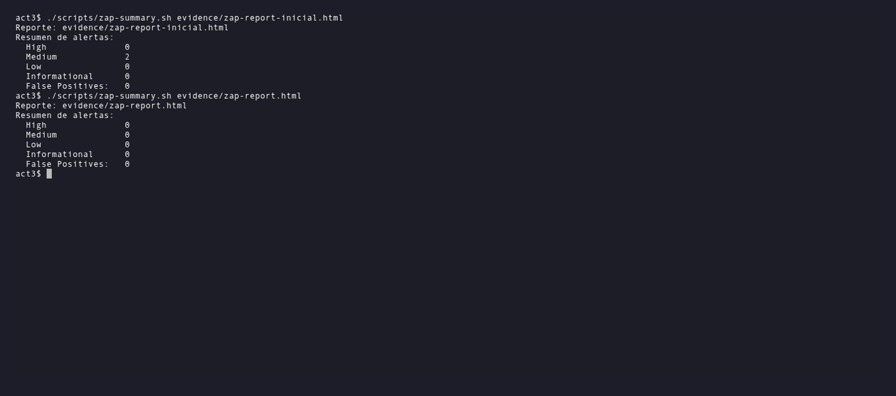
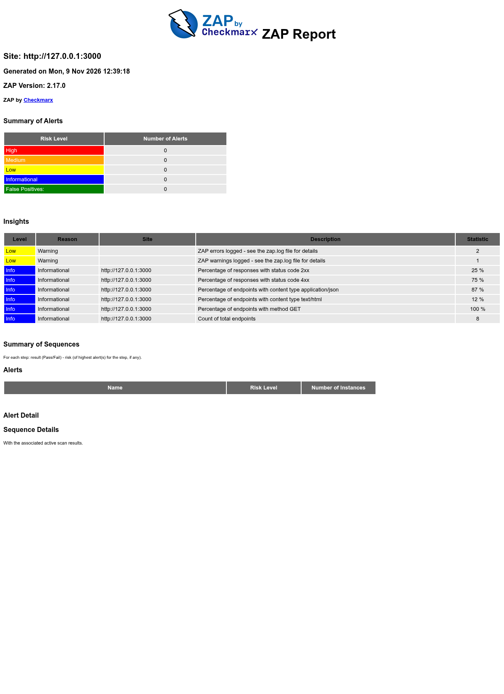
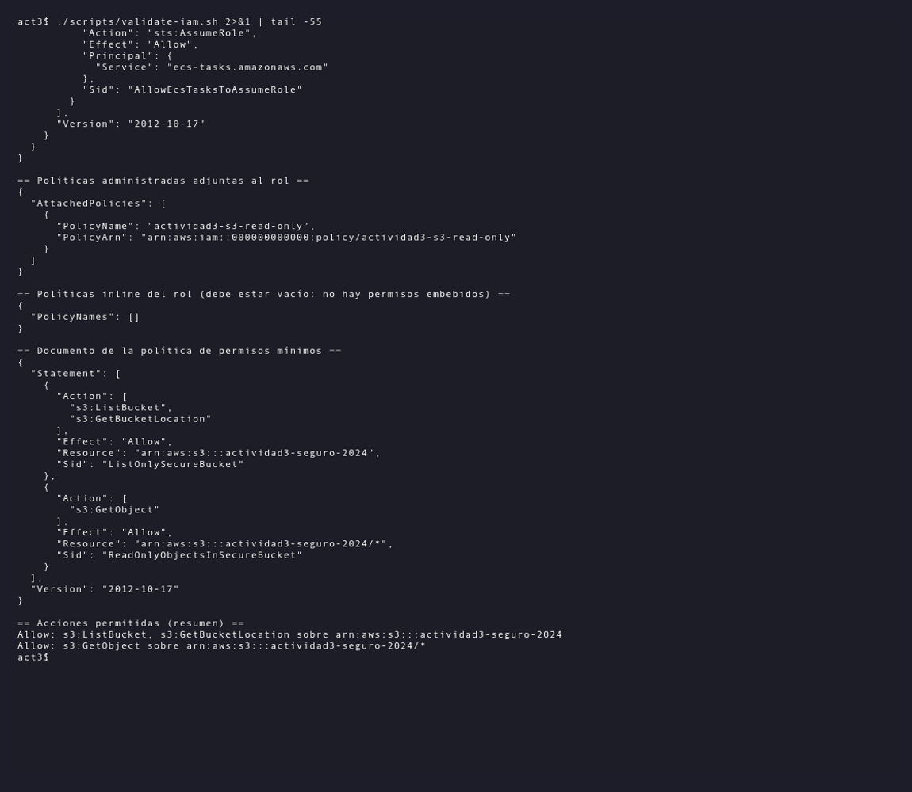
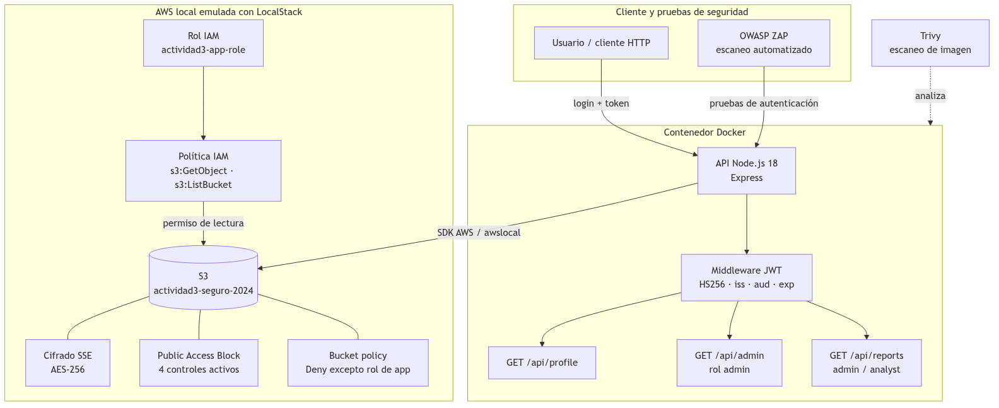

## Resumen

Implementé un entorno de seguridad en la nube de extremo a extremo con **Terraform**, **Docker**, **Trivy**, **Node.js/Express**, **JWT**, **OWASP ZAP**, **IAM** y **LocalStack**. Todo el software quedó aislado con **Nix** y el código de cada fase está en este repositorio.

| Fase | Código principal | Resultado |
| :-- | :-- | :-- |
| 1. IaC S3 | `terraform/main.tf` | Bucket cifrado AES-256, 4 bloqueos públicos y política de denegación. |
| 2. Contenedores | `docker/Dockerfile.node14`, `docker/Dockerfile.node18` | De **23 críticas** a **0 críticas** con Trivy. |
| 3. JWT + ZAP | `api/server.js` | 3 endpoints protegidos; ZAP de **2 medias** a **0 alertas**. |
| 4. IAM | `iam/app-s3-read-policy.json` | Rol con solo `s3:GetObject`, `s3:ListBucket` y `s3:GetBucketLocation`. |
| 5. Diagrama | `assets/diagram.mmd` | Arquitectura completa con S3, contenedores, API y autenticación. |

## Estructura del repositorio

El repositorio está organizado por fase. Cada carpeta contiene el código que se ejecutó y la evidencia que se generó.

```text
.
|-- api/                 # API Express con JWT
|-- assets/              # Diagrama Mermaid y PNG
|-- docker/              # Dockerfiles vulnerable y endurecido
|-- evidence/            # Capturas, reportes y logs
|-- iam/                 # Políticas IAM JSON
|-- scripts/             # Automatización y validaciones
|-- terraform/           # Infraestructura como código
|-- docker-compose.yml   # LocalStack
|-- shell.nix            # Entorno Nix
`-- README.md            # Este documento
```

| Carpeta | Contenido | Fase |
| :-- | :-- | :-- |
| `terraform/` | Bucket S3, cifrado, bloqueo público y política. | 1 |
| `docker/` | `Dockerfile.node14` vulnerable y `Dockerfile.node18` endurecido. | 2 |
| `api/` | API Express, login, middleware JWT y endpoints. | 3 |
| `iam/` | Política de mínimo privilegio y política de confianza. | 4 |
| `assets/` | Diagrama de arquitectura en Mermaid y PNG. | 5 |
| `scripts/` | Arranque de LocalStack, escaneos y validaciones. | 1-5 |
| `evidence/` | Capturas de pantalla, reportes ZAP y logs. | 1-5 |

{width=95%}

### Cómo ejecutar

```bash
cp .env.example .env          # Define JWT_SECRET
nix-shell                     # Terraform, AWS CLI, Trivy, Node, ZAP, Mermaid
./scripts/start-docker-local.sh
./scripts/start-localstack.sh
./scripts/terraform-apply.sh
./scripts/validate-s3.sh
```

El detalle completo está en `scripts/` y en el Apéndice de comandos.

## Fase 1: S3 cifrado y bloqueo público

Terraform crea el bucket `actividad3-seguro-2024` con cifrado AES-256, ACL privada, los cuatro controles de bloqueo público y una política que niega todo el acceso salvo al rol de la aplicación.

```hcl
resource "aws_s3_bucket" "secure_bucket" {
  bucket = "actividad3-seguro-2024"
}

resource "aws_s3_bucket_server_side_encryption_configuration" "secure_bucket" {
  bucket = aws_s3_bucket.secure_bucket.id
  rule {
    apply_server_side_encryption_by_default {
      sse_algorithm = "AES256"
    }
  }
}

resource "aws_s3_bucket_public_access_block" "secure_bucket" {
  bucket                  = aws_s3_bucket.secure_bucket.id
  block_public_acls       = true
  block_public_policy     = true
  ignore_public_acls      = true
  restrict_public_buckets = true
}
```

Usé recursos separados de cifrado y bloqueo público porque el bloque inline `server_side_encryption_configuration` quedó obsoleto en el proveedor AWS v5. La política adicional niega `s3:*` a cualquier principal distinto del rol:

```hcl
statement {
  sid    = "DenyEveryoneExceptAppRole"
  effect = "Deny"
  principals {
    type        = "*"
    identifiers = ["*"]
  }
  actions   = ["s3:*"]
  resources = [
    aws_s3_bucket.secure_bucket.arn,
    "${aws_s3_bucket.secure_bucket.arn}/*",
  ]
  condition {
    test     = "ArnNotEquals"
    variable = "aws:PrincipalArn"
    values   = [aws_iam_role.app_role.arn]
  }
}
```

La Figura 2 muestra el `terraform apply` con los 9 recursos creados y la Figura 3 la validación por CLI: cifrado `AES256`, los cuatro bloqueos en `true` y la política de denegación.

{width=95%}

{width=95%}

| Control | Valor observado |
| :-- | :-- |
| Cifrado por defecto | `SSEAlgorithm: AES256` |
| `BlockPublicAcls` / `IgnorePublicAcls` | `true` / `true` |
| `BlockPublicPolicy` / `RestrictPublicBuckets` | `true` / `true` |
| ACL del bucket | `private` |
| Política del bucket | `Deny` a `s3:*` salvo el rol de la app |

> **Nota:** LocalStack Community 3.8.1 no implementa `get-bucket-policy-status`. La validación se hizo con `get-bucket-encryption`, `get-public-access-block` y `get-bucket-policy`, que demuestran los mismos controles.

## Fase 2: Contenedores y Trivy

La imagen inicial usa `node:14`, una base Debian 10 sin soporte. La imagen final usa `node:18-alpine`, construcción multi-etapa, actualización de paquetes y eliminación de `npm`, `npx`, `corepack` y `yarn` del runtime.

```dockerfile
FROM node:18-alpine AS build
WORKDIR /usr/src/app
COPY package*.json ./
RUN npm ci --omit=dev --no-audit --no-fund

FROM node:18-alpine
RUN apk upgrade --no-cache \
    && rm -rf /usr/local/lib/node_modules/npm \
              /usr/local/lib/node_modules/corepack \
              /opt/yarn-* /usr/local/bin/npm /usr/local/bin/npx \
              /usr/local/bin/corepack /usr/local/bin/yarn /usr/local/bin/yarnpkg
WORKDIR /usr/src/app
COPY --from=build /usr/src/app/node_modules ./node_modules
COPY . .
USER node
CMD ["node", "server.js"]
```

| Imagen | Base | Críticas del SO | Críticas de Node | Total |
| :-- | :-- | --: | --: | --: |
| `actividad3-api:node14` | `node:14` (Debian 10) | 21 | 2 | **23** |
| `actividad3-api:node18` | `node:18-alpine` (Alpine 3.21) | 0 | 0 | **0** |

Las Figuras 4 y 5 muestran los resúmenes de Trivy. La Figura 6 muestra la tabla real del escaneo de `node14`, con los 21 hallazgos del sistema operativo Debian y los paquetes de Node.js.

{width=95%}

{width=95%}

{width=95%}

Los logs completos están en `evidence/trivy-api-node14-critical.txt` y `evidence/trivy-api-node18-critical.txt`.

## Fase 3: JWT y OWASP ZAP

La API tiene tres endpoints sensibles. El middleware valida firma HS256, emisor, audiencia y expiración; `requireRole` comprueba el rol.

| Endpoint | Requisito | Roles |
| :-- | :-- | :-- |
| `/api/profile` | Token JWT válido | Cualquiera |
| `/api/admin` | Token JWT válido | `admin` |
| `/api/reports` | Token JWT válido | `admin`, `analyst` |

```javascript
function authenticateToken(req, res, next) {
  const [scheme, token] = (req.get('authorization') || '').split(' ');
  if (scheme !== 'Bearer' || !token) {
    return res.status(401).json({ error: 'token_requerido' });
  }
  try {
    req.user = jwt.verify(token, JWT_SECRET, {
      algorithms: ['HS256'], issuer: JWT_ISSUER, audience: JWT_AUDIENCE,
    });
    return next();
  } catch (error) {
    const expired = error.name === 'TokenExpiredError';
    return res.status(401).json({
      error: expired ? 'token_expirado' : 'token_invalido',
    });
  }
}

function requireRole(...roles) {
  return (req, res, next) =>
    roles.includes(req.user?.role)
      ? next()
      : res.status(403).json({ error: 'permiso_denegado' });
}
```

Las pruebas cubren los casos `200`, `401` y `403`:

| Caso | HTTP |
| :-- | --: |
| `/api/profile` sin token | 401 |
| `/api/profile` con token | 200 |
| `/api/admin` con token admin | 200 |
| `/api/admin` con token analista | 403 |
| `/api/reports` con token analista | 200 |
| `/api/profile` con token inválido | 401 |
| Login con contraseña incorrecta | 401 |

{width=95%}

{width=95%}

ZAP encontró primero **2 alertas medias** de CSP (`Wildcard Directive` y `style-src unsafe-inline`). Endurecí Helmet con directivas explícitas y el segundo escaneo quedó en **0 alertas**.

{width=80%}

{width=95%}

{width=80%}

## Fase 4: Política IAM restrictiva

El rol `actividad3-app-role` solo puede leer el bucket. No tiene permisos de escritura, borrado ni administración.

```json
{
  "Version": "2012-10-17",
  "Statement": [
    {
      "Sid": "ListOnlySecureBucket",
      "Effect": "Allow",
      "Action": ["s3:ListBucket", "s3:GetBucketLocation"],
      "Resource": "arn:aws:s3:::actividad3-seguro-2024"
    },
    {
      "Sid": "ReadOnlyObjectsInSecureBucket",
      "Effect": "Allow",
      "Action": ["s3:GetObject"],
      "Resource": "arn:aws:s3:::actividad3-seguro-2024/*"
    }
  ]
}
```

Terraform crea el rol, la política y la asociación; el usuario `actividad3-auditor` queda sin la política para demostrar que el permiso es exclusivo del rol. La Figura 12 muestra la validación: política adjunta, sin políticas inline y con solo las tres acciones permitidas.

{width=95%}

> **Limitación del emulador:** LocalStack Community no aplica políticas IAM en runtime (es una función Pro). La política y su asociación quedan demostradas; en AWS real, `s3:PutObject` y `s3:DeleteObject` responderían `AccessDenied`.

## Fase 5: Diagrama de arquitectura

El diagrama se generó con Mermaid CLI desde `assets/diagram.mmd`. La Figura 13 muestra el resultado e incluye los cuatro componentes de la rúbrica: S3, contenedores, API y autenticación, además de ZAP, Trivy, cifrado, bloqueo público, bucket policy y rol IAM.

{width=100%}

| Componente | Función |
| :-- | :-- |
| S3 `actividad3-seguro-2024` | Almacenamiento cifrado y privado. |
| Contenedor API Node.js 18 | Ejecuta Express y los endpoints. |
| Middleware JWT | Valida firma, emisor, audiencia y expiración. |
| Rol y política IAM | Aplican mínimo privilegio sobre S3. |
| ZAP y Trivy | Verifican la API y la imagen del contenedor. |

## Resultados y rúbrica

| Criterio | Peso | Evidencia | Estado |
| :-- | --: | :-- | :-- |
| 1. IaC con cifrado y bloqueo de acceso | 25 % | `terraform/main.tf`; Figuras 2 y 3. | Cumplido |
| 2. Contenedores y escaneo con Trivy | 20 % | Dockerfiles y escaneos; Figuras 4, 5 y 6. | Cumplido |
| 3. Validación JWT y ZAP | 25 % | `api/server.js`; Figuras 7 a 11. | Cumplido |
| 4. Política IAM restrictiva | 20 % | `iam/*.json`; Figura 12. | Cumplido |
| 5. Diagrama de arquitectura | 10 % | `assets/diagram.mmd`; Figura 13. | Cumplido |

## Conclusiones

- La seguridad se construye por capas: cifrado, bloqueo público, IAM, JWT y escaneos.
- La imagen de contenedor pasó de 23 vulnerabilidades críticas a cero al cambiar la base, reducir paquetes y eliminar herramientas innecesarias.
- La evidencia es parte del trabajo: comandos, capturas y reportes permiten verificar cada control.
- Nix, Docker, LocalStack y Terraform hacen que todo el entorno sea reproducible y portable a AWS real.

## Referencias

- HashiCorp. (s. f.). *Terraform: Install Terraform*. https://developer.hashicorp.com/terraform/install
- Aqua Security. (2025). *Trivy: Vulnerability Scanner for Containers*. https://trivy.dev
- OWASP Foundation. (2025). *ZAP: Zed Attack Proxy*. https://www.zaproxy.org
- LocalStack. (2025). *LocalStack Documentation*. https://docs.localstack.cloud
- AWS. (2025). *Amazon S3: Blocking public access*. https://docs.aws.amazon.com/AmazonS3/latest/userguide/access-control-block-public-access.html
- AWS. (2025). *IAM: Policies and permissions*. https://docs.aws.amazon.com/iam/

## Apéndice: comandos de reproducción

```bash
cp .env.example .env
nix-shell
./scripts/start-docker-local.sh
./scripts/start-localstack.sh
./scripts/terraform-apply.sh
./scripts/validate-s3.sh
docker build -f docker/Dockerfile.node14 -t actividad3-api:node14 api
docker build -f docker/Dockerfile.node18 -t actividad3-api:node18 api
./scripts/scan-image.sh actividad3-api:node14
./scripts/scan-image.sh actividad3-api:node18
./scripts/run-api.sh
./scripts/validate-jwt.sh
./scripts/validate-iam.sh
mmdc -i assets/diagram.mmd -o assets/diagram.png -b white -w 1600
```
